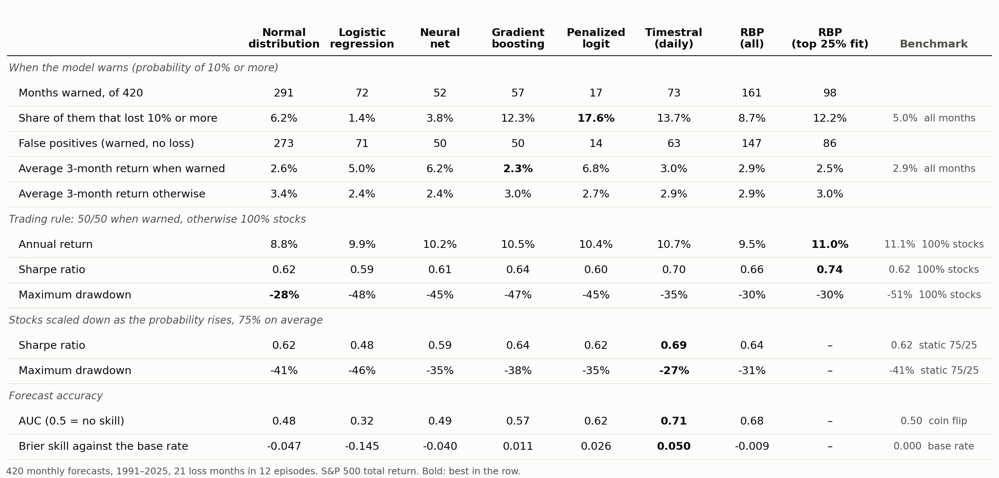
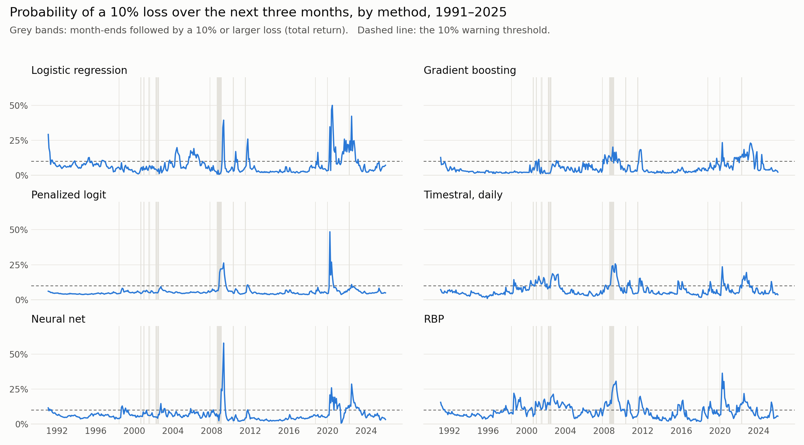

# Will the S&P 500 fall 10% in the next three months?

A team project for MIT 15.451, Investment Management Lab (fall 2026), on a question posed by Harvard Management Company: estimate the probability that the S&P 500 loses more than 10% over the next three months, and show with a back-test whether the estimate is robust.

We built and compared about ten ways of producing that probability, from a normal distribution to relevance-based prediction, machine learning and a time-series foundation model. The fitted methods get the same thirteen predictors, and every method is scored on the same 420 monthly forecasts, 1991–2025, each made only from data known at the time.

## What we found

- **No method clearly beats volatility.** The 420 forecasts contain only 21 loss months, in 12 separate episodes, so most differences between methods are within noise. A block bootstrap (`analysis/bootstrap.py`) says which differences hold up.
- **Warnings come during falls more than before them.** Months the better models flag lose 10% two to three times as often as the 5% base rate, but the warnings cluster near the bottom of 2008 and 2020, just before rebounds.
- **The trading rule still pays.** Moving to 50/50 when warned cuts the maximum drawdown from −51% (all stocks) to about −30% with RBP, for a higher Sharpe ratio (0.66, or 0.74 when RBP's fit is high).
- **Flexible machine learning adds little with so few episodes.** With settings chosen on 1961–1990 only, the neural net and gradient boosting rank months barely better than chance.
- **A vol-scaled model gives the most accurate probabilities** on the thirteen predictors (Brier skill 0.056, AUC 0.69): it forecasts next-quarter volatility, which every month informs, rather than classifying the rare loss months, and reads the probability off volatility-scaled past returns (`analysis/volscale.py`).

The slides we presented on 2026-10-22 are in [deck/sp500-drawdown-risk-2026-10-22.pptx](deck/sp500-drawdown-risk-2026-10-22.pptx), with speaker notes. Every score is in [data/compare/scores.csv](data/compare/scores.csv).

## The set-up

- **Event:** the S&P 500 total return over the next three months is −10% or worse.
- **Forecasts:** at each month-end, using only data published by then: macro series from their release vintages (ALFRED), market data from the day before.
- **Training:** models that fit refit every month on all months since 1930 whose outcome is known.
- **Scores:** months warned and the share that lost 10%, false positives, the average return after a warning, two trading rules, Brier skill and AUC.

The thirteen predictors:

| Predictor | Column | From |
|---|---|---|
| Past 3-month total return | `logret_past_3m_tr` | 1928 |
| Trailing volatility, 63 days | `vol_trailing63_tr` | 1928 |
| GJR-skew-t GARCH volatility forecast, 63 days | `gjr_skewt_vol_q` | 1938 |
| Turbulence, 17 industries | `turb17` | 1930 |
| Absorption-ratio shift, 17 industries | `ar17_shift` | 1929 |
| Credit spread, Baa − Aaa | `credit_baa_aaa` | 1928 |
| Yield-curve slope, long rate − 3-month bill | `yc_long` | 1934 |
| CAPE, point in time | `cape` | 1928 |
| Concentration (HHI) of the S&P 500 | `hhi` | 1957 |
| Industrial production, 12-month growth | `ip_growth_12m` | 1928 |
| CPI inflation, 12-month | `cpi_infl_12m` | 1949 |
| Unemployment change, 12-month | `unrate_chg_12m` | 1960 |
| Michigan consumer sentiment | `sentiment_umich` | 1952 |

## The methods

| Method | Code |
|---|---|
| Normal distribution and empirical frequency | `analysis/baseline.py`, `analysis/results_table.py` |
| GARCH family (GARCH, TGARCH, GJR with skew-t and filtered historical simulation) | `analysis/volatility_michal.ipynb` |
| VIX, absorption ratio and turbulence | `analysis/volatility.py`, `analysis/absorption_ratio.py`, `analysis/turbulence.py` |
| Logistic regression, plain and penalized | `analysis/logistic.py`, `analysis/logit_tstats.py`, `analysis/ml.py` |
| Neural net and gradient boosting | `analysis/ml.py`, `analysis/ml_importance.py` |
| Relevance-based prediction (RBP) | `analysis/rbp.py`, `analysis/rbp_crisis.py`, `analysis/rbp_report.py` |
| Timestral, Mistral AI's time-series foundation model, zero-shot | `analysis/timestral_forecast.py` |
| Vol-scaled model | `analysis/volscale.py` |
| Option-implied signals | `analysis/hmc_option_pricing_updated.py` |
| Back-test, trading rules and comparison | `analysis/backtest.py`, `analysis/compare.py`, `analysis/bootstrap.py` |

## What is here

| Path | Holds |
|---|---|
| `analysis/` | All the code, one script per method. Run from the repository root. |
| `data/` | Our results: forecasts, scores, predictor importance, the fragility indices and GARCH fits. [data/README.md](data/README.md) lists every input and where to download it. |
| `deck/` | The presentation as given, and its figures in `deck/figures/`. |

The raw inputs are not included: several are copyrighted or licensed (CRSP via WRDS, Yahoo, Cboe, Moody's, Nasdaq, the University of Michigan). RBP was run with Cambridge Sports Analytics' engine, which is not public, so `analysis/rbp.py` needs access to it.

Python 3 with pandas, numpy, scipy, scikit-learn, statsmodels, arch, matplotlib and openpyxl; `torch` and Mistral's `timestral` package for the foundation model; `wrds` to pull CRSP.

## Team

- Michal Bem ([@StrongLargeDoggo](https://github.com/StrongLargeDoggo))
- Flynn Kelleher ([@fpk24](https://github.com/fpk24))
- Kan ([@kantanatp](https://github.com/kantanatp))
- Qianying Ma ([@Qianying-m](https://github.com/Qianying-m))
- Karel Moryoussef ([@xkarelm](https://github.com/xkarelm))
- Pir Mujtaba ([@panda200102](https://github.com/panda200102))
- Connor O'Neil ([@conormoneill77](https://github.com/conormoneill77))
- Maria Ryabova
- Rafa Salama
- Maxime Vallot ([@maximevallot](https://github.com/maximevallot))
- Samantha Vun ([@samjhvun](https://github.com/samjhvun))
- Olivia Yuan ([@xiaohan-yuan](https://github.com/xiaohan-yuan))

Course taught by Mark Kritzman. With thanks to Jake Xia (Harvard Management Company), and to Cel Kulasekaran and Cambridge Sports Analytics for the RBP engine. AI assistants (Claude Code, Codex) helped write, review and debug parts of the code, as the course allows.

## Licence

The code is under the [MIT License](LICENSE). The presentation uses MIT Sloan's slide template.
